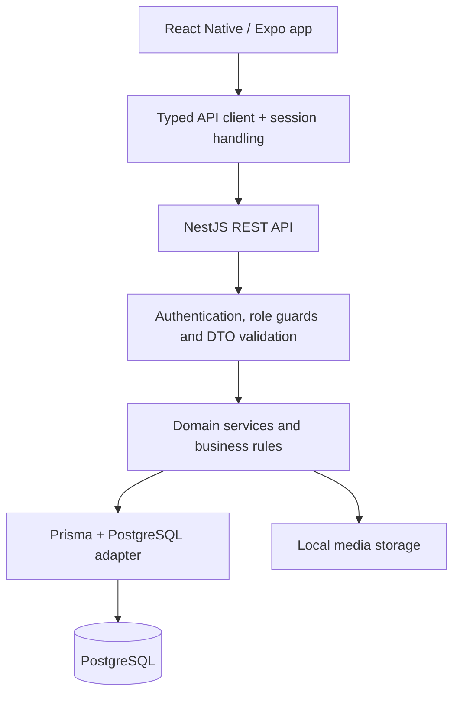

<div align="center">
  <picture>
    <source media="(prefers-color-scheme: dark)" srcset="mobile/assets/branding/trimly-wordmark-dark.png">
    
  </picture>

  <h1>Barber appointments, thoughtfully managed.</h1>

  <p>A mobile platform connecting customers with barbershops — from discovering a business<br>to booking an appointment and managing the experience afterwards.</p>

  <p>
    
    
    
    
    
  </p>

  <p><a href="#the-product">Product</a> · <a href="#architecture">Architecture</a> · <a href="#running-locally">Local setup</a> · <a href="#quality--testing">Testing</a> · <a href="#project-status--next-steps">Roadmap</a></p>
</div>

---

## Overview

Trimly brings the customer experience and day-to-day barbershop operations into one application. Customers discover businesses, choose a service and barber, and book an available time. Business teams manage their schedules, appointments, services and customer records through a separate, role-aware workspace.

The project focuses on the parts that make booking systems difficult in practice: concurrent reservations, service durations, local time zones, participant identity, schedule changes, permissions and customer consent.

**Status:** actively developed, pre-release application. The interface currently targets Turkish-speaking users and supports light and dark themes. This repository contains the mobile app, backend API, database migrations and product documentation; it is not a hosted public demo.

## The product

### For customers

- **Discover businesses:** browse barbershops, search nearby locations, view services, staff, opening hours, galleries and reviews.
- **Book with real availability:** select a participant, service, barber and time based on service duration and the employee's schedule.
- **Book for family members:** manage dependent profiles and keep appointments and haircut history separated by participant.
- **Manage appointments:** view upcoming and past bookings, respond to business-initiated change proposals and cancel within the applicable rules.
- **Keep a personal history:** revisit haircut records, save styles and manage photo permissions.
- **Stay informed:** receive in-app notifications, appointment reminders and reliability or appeal updates.

### For business teams

- **Manage the day:** appointment lists, a staff-aware calendar and daily summaries.
- **Control availability:** business hours, employee shifts, breaks, time off and booking settings.
- **Maintain the storefront:** business information, location, contact details, cover image and gallery.
- **Manage services and staff:** service prices and durations, active/bookable status and team invitations.
- **Handle the appointment lifecycle:** arrival, completion, cancellation with a reason and time-change proposals requiring customer acceptance.
- **Record the result:** haircut notes and photos with consent-aware access and portfolio publication controls.
- **Review operations:** business revenue summaries, cancellation reliability and appeal workflows.

### Roles and access

Business permissions are scoped to an active membership in a particular barbershop. They are enforced in the backend, not just by hiding controls in the app.

| Role | Intended scope |
| --- | --- |
| Customer | Own account, dependent profiles, bookings and permitted personal records. |
| Owner | Business ownership and management operations. |
| Manager | Operational management through authorized business endpoints. |
| Barber | Assigned appointments and permitted employee operations. |
| Apprentice | Read-only employee workspace; not eligible to receive bookings. |

The exact authorization rules live in the endpoint guards and service-level checks.

## Architecture



### Technology stack

| Layer | Implementation |
| --- | --- |
| Mobile | React Native, React, TypeScript, Expo and Expo Router |
| UI | Shared themed components, light/dark palettes, Inter and Playfair Display |
| Client data access | Typed fetch-based API client, short-lived GET caching and in-flight request deduplication |
| Session persistence | Expo SecureStore |
| Device features | Location and maps, camera, image picker and notifications |
| Backend | NestJS, modular REST controllers and domain services |
| Authentication | JWT / Passport, bcrypt, email verification and password recovery |
| Data | PostgreSQL, Prisma, SQL migrations and transactional validation |
| API documentation | Swagger / OpenAPI |
| Tests | Jest, Nest testing utilities and Supertest |

### Engineering decisions

- **Backend-owned business rules.** DTO validation, membership checks and service-level policies validate requests independently of the mobile UI.
- **Concurrency protection.** Appointment transactions, PostgreSQL exclusion constraints and advisory locks protect against overlapping bookings and participant-limit races.
- **Time-zone-aware scheduling.** Availability uses the business's local date, working hours, employee schedules, breaks and existing appointments.
- **Historical snapshots.** Appointment records preserve relevant participant and service details rather than relying solely on mutable profile data.
- **Explicit change proposals.** A business cannot silently replace a customer's confirmed appointment; acceptance revalidates availability before applying the change.
- **Safe schedule and team changes.** Effective-date handling and appointment-impact checks protect existing reservations when operating hours or employee availability change.
- **Consent-aware media.** Private haircut photos and public portfolio publication use separate permission checks, including guardian consent for minors.
- **Customer-weighted ratings.** Rating aggregation averages each customer's ratings before combining them, reducing the influence of frequent repeat reviewers.

### Repository structure

```text
trimly/
├── mobile/
│   ├── src/app/            # Expo Router screens and route groups
│   ├── src/features/       # Customer and business feature modules
│   ├── src/components/     # Shared UI components
│   ├── src/lib/            # API client and navigation utilities
│   ├── src/theme/          # Theme configuration
│   └── assets/             # Branding and bundled imagery
├── backend/
│   ├── src/modules/        # Domain controllers and services
│   ├── src/common/         # Guards, validation helpers and HTTP handling
│   ├── src/database/       # Prisma integration
│   ├── prisma/models/      # Domain data models
│   ├── prisma/migrations/  # SQL schema and integrity migrations
│   └── test/               # API end-to-end tests
└── docs/                   # Product rules, roadmap and release checks
```

## Running locally

### Prerequisites

- Node.js **22.12+** and npm.
- A running PostgreSQL instance and an empty development database.
- Permission to install the PostgreSQL `btree_gist` extension, used by the appointment overlap constraint.
- A compatible Expo Go installation, or native tooling for an iOS/Android development build. iOS Simulator requires macOS and Xcode.

The backend and mobile app have separate dependencies and environment files. Run the following commands from the repository root unless noted otherwise.

<details>
<summary><strong>1. Backend setup and environment configuration</strong></summary>

```bash
cd backend
npm ci
cp .env.example .env
```

Edit `backend/.env` before proceeding:

| Variable | Local configuration |
| --- | --- |
| `DATABASE_URL` | Connection string for your development database. |
| `SHADOW_DATABASE_URL` | Separate disposable database for `prisma migrate dev`; never point this at the application database. Not needed for `migrate deploy` below. |
| `JWT_SECRET` | Replace the example with a long, random value. |
| `EMAIL_VERIFICATION_SECRET` | Use an independent, long, random value. |
| `PUBLIC_API_URL` | Backend URL reachable by the client, especially when testing image links on a physical phone. |
| `SMTP_*`, `EMAIL_FROM` | Optional locally; without SMTP, development verification codes are logged in the backend terminal. |

The example database ports reflect one local development setup. Replace them with your own PostgreSQL host, port, database and credentials.

Generate the client, apply the committed migrations and start the API:

```bash
npm run prisma:generate
npx prisma migrate deploy
npm run start:dev
```

With the default port:

- Health endpoint: <http://localhost:3000/health>
- Swagger UI: <http://localhost:3000/api/docs>

Swagger availability is controlled by `SWAGGER_ENABLED` and the environment configuration.

</details>

<details>
<summary>Optional: development seed data</summary>

From `backend/`, run:

```bash
npm run prisma:seed
```

The seed populates example businesses, employees, services and schedules. Development login information is printed by the seed script. Use it only with a disposable local database; seed accounts must not be exposed on a public deployment. Business publication and booking-readiness requirements still apply.

</details>

<details>
<summary><strong>2. Mobile setup, simulator and physical-device access</strong></summary>

In a second terminal, from the repository root:

```bash
cd mobile
npm ci
cp .env.example .env
```

Set `EXPO_PUBLIC_API_URL` in `mobile/.env`:

| Client | Example backend URL |
| --- | --- |
| iOS Simulator on the backend's Mac | `http://localhost:3000` |
| Android Studio emulator | `http://10.0.2.2:3000` |
| Physical phone on the same Wi-Fi | `http://<your-computer-LAN-IP>:3000` |

Then start Expo:

```bash
npx expo start --go --lan
```

Scan the terminal QR code with a compatible Expo Go app, or press `i` / `a` to open an available simulator or emulator. If your Expo Go version is incompatible with this project's SDK or a native capability needs a development build, use `npm run ios` or `npm run android` with the required native tools installed.

**Phone testing:** `localhost` on a phone means the phone itself, not your computer. Both devices must be able to reach each other on the network, and port `3000` must be accessible. An Expo tunnel only exposes the JavaScript development server; it does not automatically expose the backend. Restart Expo after changing the API environment variable.

</details>

## Quality & testing

The repository includes unit tests for availability-related rules, authorization, participant limits, change proposals, no-show handling, cancellation reliability, dependent profiles, media consent and public profile summaries. API end-to-end suites cover authentication, health, customer access, penalty flows and cancellation recovery.

<details>
<summary><strong>Run automated tests and static checks</strong></summary>

From `backend/`:

```bash
npm test -- --runInBand
npm run test:cov -- --runInBand
npm run build
```

API end-to-end tests require a **separate, migrated test database**. Configure `DATABASE_URL` for that database and use development/test settings, then run:

```bash
npm run test:e2e
```

These tests create and clean up database records. Never run them against production or a database containing valuable user data.

From `mobile/`:

```bash
npx tsc --noEmit
npm run lint
```

</details>

Automated tests are complemented by the real-device, theme, navigation and release checks tracked in the product documentation. Their presence does not imply that every release check is complete.

## A suggested review path

For a quick technical walkthrough:

1. Start with [appointment services](backend/src/modules/appointments/) and [availability](backend/src/modules/availability/) for booking rules and lifecycle handling.
2. Review [authorization guards](backend/src/common/guards/) and [database migrations](backend/prisma/migrations/) for permission and data-integrity enforcement.
3. Explore [mobile routes](mobile/src/app/) and [feature modules](mobile/src/features/) to see how the customer and business workspaces connect to the API.
4. Read the [business rules and roadmap](docs/product-rules-roadmap.md) for product decisions, edge cases and remaining work.

## Project status & next steps

The core customer and business workflows are implemented, with ongoing correctness, usability and release-readiness work.

Current priorities include:

- Complete the critical-path navigation and real-device test matrix.
- Expand integration coverage for concurrency, schedule changes and permission boundaries.
- Finish production deployment preparation, media storage strategy and operational monitoring.
- Validate onboarding, accessibility and small-screen layouts across both themes.

**Planned, not implemented:** a premium AI Business Assistant for natural-language questions and controlled business actions. The intended architecture uses existing backend services, role checks, confirmation previews and audit logs; it must not directly modify the database or bypass business rules.

Detailed planning documents are currently maintained in Turkish:

- [Product specification](docs/product-spec.md)
- [Business rules and roadmap](docs/product-rules-roadmap.md)
- [Development backlog](docs/TODO.md)
- [Launch polish checklist](docs/launch-polish.md)

## Security & deployment notes

- Keep real `.env` files, signing keys, database backups and user uploads out of version control.
- `EXPO_PUBLIC_*` values are shipped to the client and must never contain secrets.
- Local media is currently stored on the backend filesystem. A deployment needs persistent storage, backups and a stable, externally reachable asset URL.
- Production requires independent secrets, SMTP configuration, HTTPS and an explicit web-origin policy. Development seed credentials are not production credentials.
- This README describes the current development architecture, not a production security certification.

## License

No open-source license is granted by this repository. All rights reserved unless separate permission is provided by the author.
